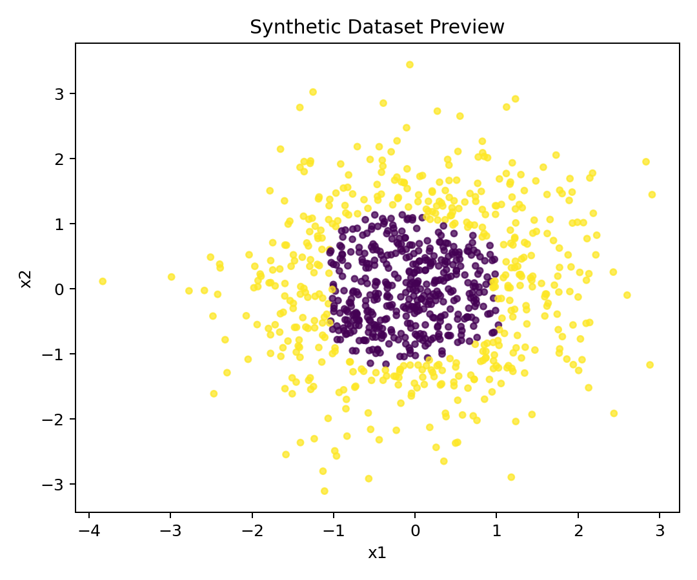
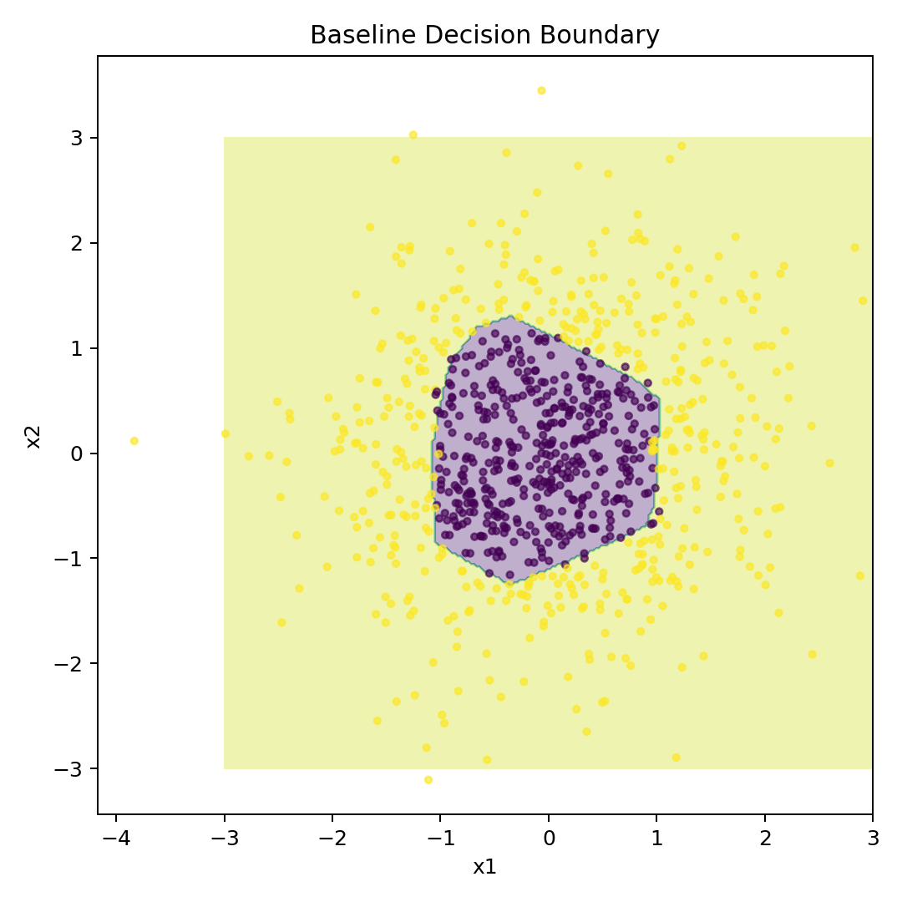
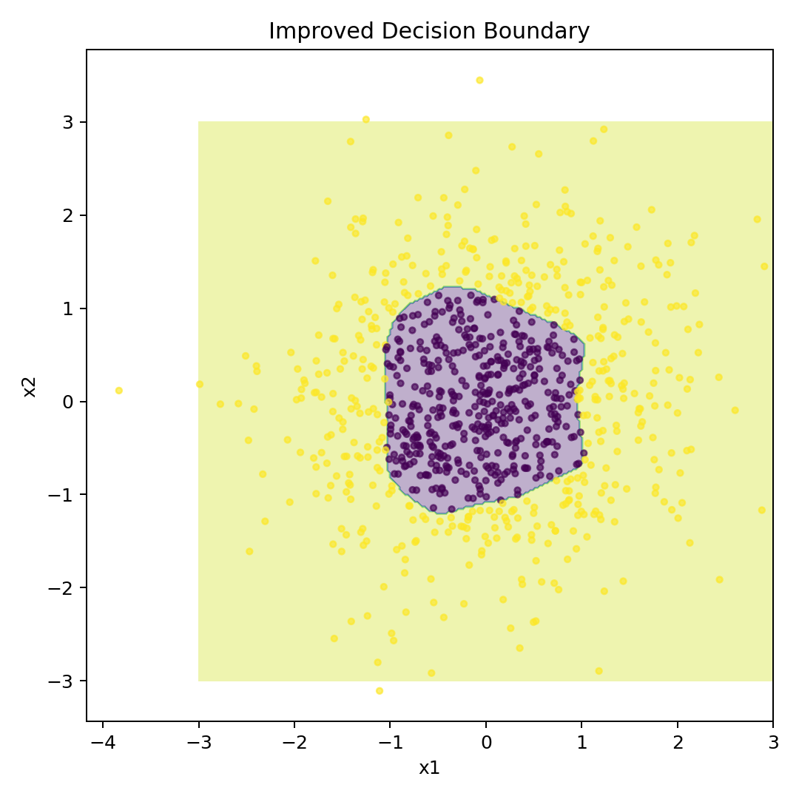
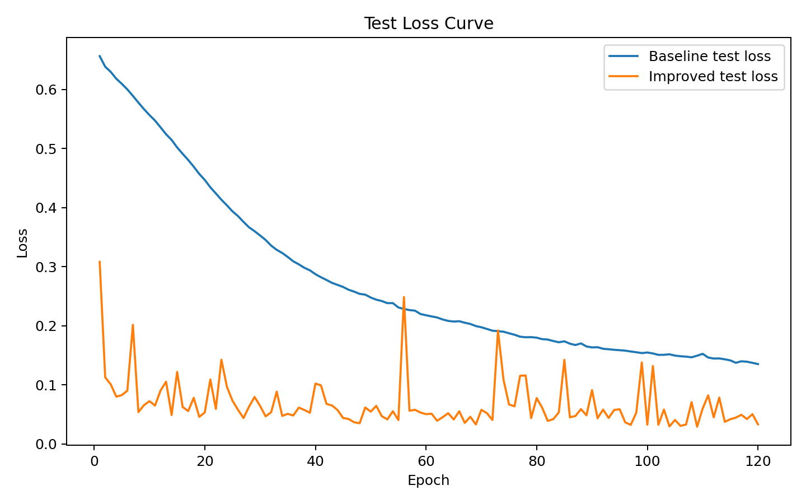
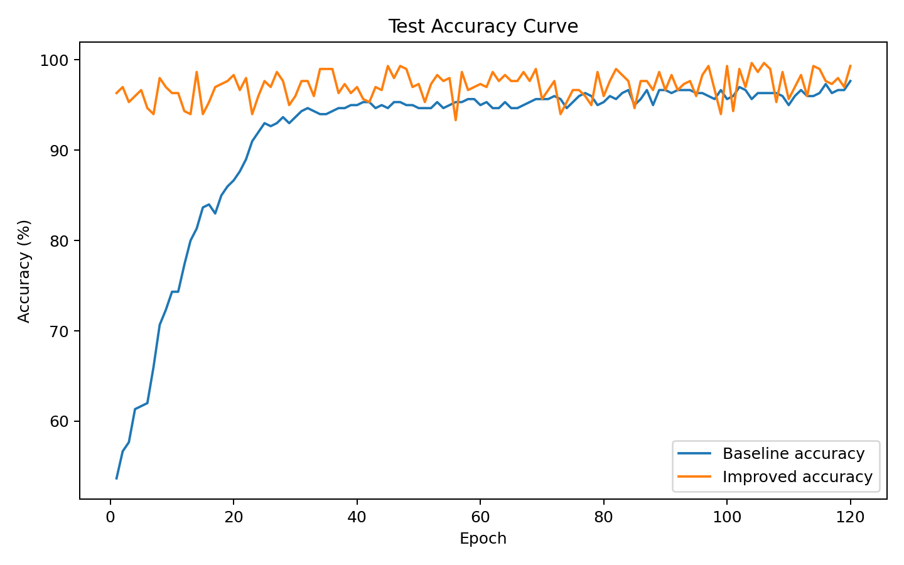
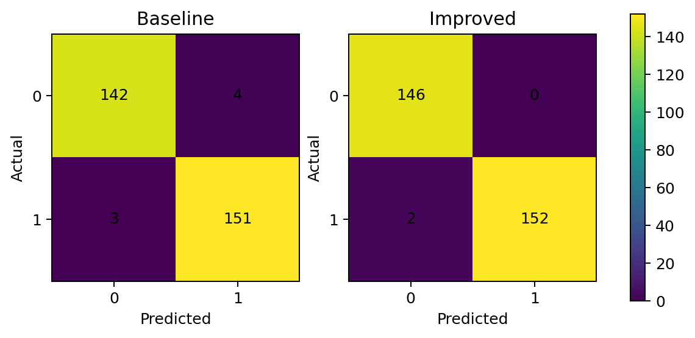

<p align="center"></p>

<h1 align="center">🧠 PyTorch MLP 实验</h1>

<p align="center">二维合成数据上的 MLP 配置对比</p>

<p align="center"> </p>

在二维非线性分类数据上比较两种MLP配置，保存训练曲线、决策边界、混淆矩阵和结构化结果。入口包含数据生成、训练、评估与可视化。

[代码与参数](train_compare.py) · [实验分析](docs/EXPERIMENT_REPORT.md) · [设计说明](docs/DESIGN_NOTES.md) · [验证记录](VERIFICATION.md)

## 📊 保存的实验图

保存实验的六张图，可点击查看完整分辨率。

<p align="center"><a href="assets/dataset_preview.png"></a></p>

### 数据与决策边界

<p align="center">
<a href="assets/decision_boundary_baseline.png"></a>
<a href="assets/decision_boundary_improved.png"></a>
</p>

### 训练曲线

<p align="center">
<a href="assets/loss_curve.png"></a>
<a href="assets/accuracy_curve.png"></a>
</p>

### 混淆矩阵

<p align="center"><a href="assets/confusion_matrices.png"></a></p>

## 🧪 实验设置

默认生成1200个二维样本，seed42，900训练/300测试，CPU历史记录为120轮。标准化只使用训练集统计量。

| 配置 | Baseline | Improved |
|---|---|---|
| 网络 | 2 → 8 → 2 | 2 → 32 → 32 → 2 |
| 输入 | 原始特征 | 训练统计标准化 |
| 激活 | ReLU | LeakyReLU |
| 优化器 / 学习率 | SGD / 0.05 | Adam / 0.01 |
| 参数量 | 42 | 1218 |

## 📈 历史结果

来自 [summary.json](results/summary.json) 的单seed CPU记录：

| 配置 | 参数 | Train loss | Test loss | Test accuracy |
|---|---:|---:|---:|---:|
| Baseline | 42 | 0.1224 | 0.1354 | 97.67% |
| Improved | 1218 | 0.0238 | 0.0334 | 99.33% |


逐轮记录见[history.csv](results/history.csv)，控制台示例见[example_output.txt](results/example_output.txt)。

## 🚀 复现与轻量检查

依赖见[requirements.txt](requirements.txt)：torch≥2.0、NumPy≥1.23、Matplotlib≥3.7；已验证环境为Python3.11，GPU可选。

```bash
pip install -r requirements.txt
python -m unittest discover -s tests -v
```

重跑实验时使用独立输出目录，保留仓库中的历史结果：

```bash
python train_compare.py --cpu --output-dir runs/local/results --assets-dir runs/local/assets
python train_compare.py --help
```

入口支持样本数、测试比例、轮数、batch size、学习率、seed、CPU线程及 `--no-plots`。默认值以帮助输出和源码为准。

## 🛠️ 验证与解释边界

5项无训练CPU检查已通过，覆盖默认900/300划分、极端比例拒绝、训练统计标准化与42/1218参数量，见[验证记录](VERIFICATION.md)。图表和准确率来自保存的单seed CPU实验，没有新增训练或CUDA验收记录。

两组配置同时改变容量、标准化、激活和优化器，没有逐因素消融或多seed统计，不能分解各因素的贡献或推广为真实数据性能。训练时逐epoch观察测试指标；更严格的比较需要独立验证集与未参与开发的最终测试集。

## 📁 文件与许可

`train_compare.py`是入口，`tests/`保存小型数据/结构检查，`assets/`与`results/`保存历史图表和结果，`docs/`保存实验分析。`runs/`用于本地复现输出，已排除Git跟踪。

保留[MIT LICENSE](LICENSE)。原六张实验PNG不作改动；资源来源见[assets说明](assets/README.md)。[公开文件清单](PUBLIC_FILES_MANIFEST.md) · [排除清单](EXCLUDED_FILES.md)
